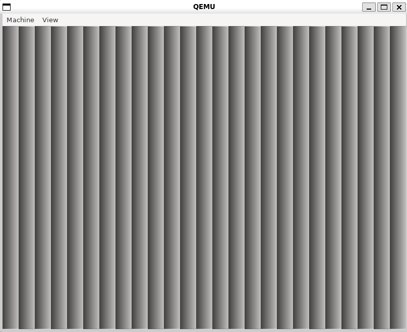
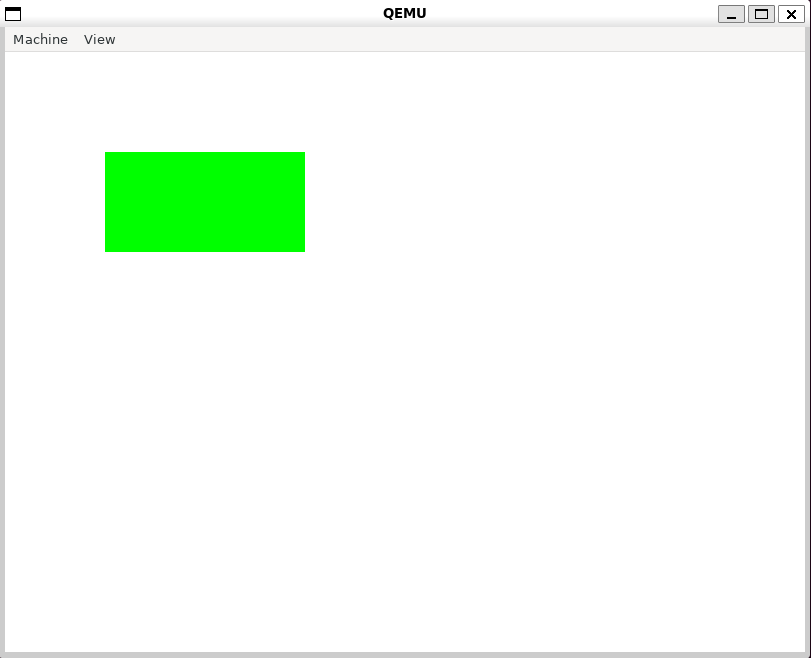
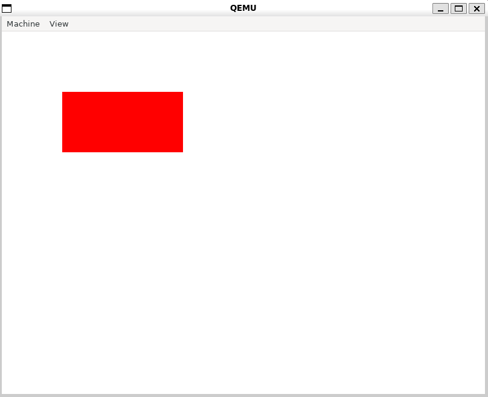

# 第4章 ピクセル描画と make 入門

## 4a: Makefile でカーネルをビルドする

### Makefile とは
「何から何を、どうやって作るか」を書いたレシピ。`make` コマンドで実行する。
```makefile
kernel.elf: main.o Makefile        # kernel.elf は main.o と Makefile から作る（依存関係）
	ld.lld $(LDFLAGS) -o kernel.elf main.o
%.o: %.cpp Makefile                # ○○.o は ○○.cpp と Makefile から作る
	clang++ $(CPPFLAGS) $(CXXFLAGS) -c $<
```
- 作り方の行の先頭は、空白ではなくタブ文字でなければならない。

### make の動き（確認した結果）
- `make` はファイルの更新時刻を比べ、**変更があったものから作られるものだけを作り直す**。
- 何も変更していなければ、何も作り直さない（`Nothing to be done for 'all'.`）。
- `main.cpp` を変更すると、コンパイル（main.o の作成）とリンク（kernel.elf の作成）の両方が実行される。
  変更は依存関係の矢印に沿って伝わる：main.cpp → main.o → kernel.elf
- `Makefile` を変更すると、両方のルールの右側に Makefile があるので、main.o と kernel.elf の両方が作り直される。
- `touch` コマンドで更新時刻だけを変えても、make からは「変更された」と判断される。

### 公式の Makefile から変えた点
- 公式の Makefile は本の当時のリンカ向けなので、`LDFLAGS` に `-z separate-code` を追加した（第3章の問題の再発防止）。
- `CPPFLAGS` は Makefile では設定せず、`source buildenv.sh` で設定した環境変数を使う。

### 実行結果
第3章（3c）と同じ縞模様が表示された。ビルド方法を Makefile に変えても、同じカーネルが作られている。



---

## 4b: 座標を指定して画素を描く（WritePixel）

### 座標からバイトの位置を求める
```
画素 (x, y) の先頭バイト ＝ 4 ×（pixels/line × y ＋ x）
```
- `pixels/line × y`：y 行分を丸ごと飛ばす
- `＋ x`：その行の中で x 画素進む
- `4 ×`：画素の単位からバイトの単位に直す
- 例：(100, 50) → 画素の番号は 50 × 800 + 100 = 40,100 → 青は 160,400 バイト目、赤は 160,402 バイト目
- 「画素の単位」と「バイトの単位」を混ぜて足さないこと。

### FrameBufferConfig
- ブートローダーが、フレームバッファの番地・pixels/line・解像度・画素の形式を構造体にまとめてカーネルに渡す。
- 800 を決め打ちにしない。解像度は環境によって変わり、`pixels/line` は横の解像度と一致するとは限らない（行末に詰め物がある画面もある）。
- 定義（`frame_buffer_config.hpp`）は、カーネルとブートローダーで共有する（シンボリックリンク）。片方だけ変えると、受け渡しの中身がずれるため。

### WritePixel
```cpp
int WritePixel(const FrameBufferConfig& config, int x, int y, const PixelColor& c) {
  const int pixel_position = config.pixels_per_scan_line * y + x;
  if (config.pixel_format == kPixelRGBResv8BitPerColor) {
    uint8_t* p = &config.frame_buffer[4 * pixel_position];
    p[0] = c.r;  p[1] = c.g;  p[2] = c.b;
  } else if (config.pixel_format == kPixelBGRResv8BitPerColor) {
    uint8_t* p = &config.frame_buffer[4 * pixel_position];
    p[0] = c.b;  p[1] = c.g;  p[2] = c.r;
  } else {
    return -1;
  }
  return 0;
}
```
- 呼び出す側は `{r, g, b}` で色を指定するだけ。画面が RGB か BGR かは `WritePixel` の中で吸収する。
  → **ハードウェアの違いを関数の中に閉じ込めて、使う側から見えなくする**（OS の大事な役割）。
- 1画素の4バイト目は「予約（Reserved）」。透明度ではない。

### 実行結果
KernelMain は、まず画面全体を白 `{255, 255, 255}` で塗り、その上に (100, 100) から横 200 × 縦 100 の範囲を緑 `{0, 255, 0}` で塗る。



- RGB が全部 255 で白。
- 後から塗った緑の長方形が、白の上に表示される（最後に書いたものが映る）。

### 実験：画素の形式をわざと間違える
ブートローダーで、本当は BGR の画面を RGB と設定してカーネルに渡し、長方形を青 `{0, 0, 255}` で描いた。



- 青を指定したのに、**赤** が表示された。
```
指定した色       : {r=0, g=0, b=255}（青）
形式を RGB と誤認 : p[0] = r = 0,  p[1] = g = 0,  p[2] = b = 255
実際の画面（BGR）: p[2] を赤として表示 → 赤
```
- 入れ替わるのは R と B（`p[0]` と `p[2]`）だけ。G はどちらの形式でも `p[1]` なので入れ替わらない。
- そのため、白や緑で描いても、形式を間違えたことは画面に表れない。
  **確かめたい違いが表に出る入力を選ばないと、実験しても何もわからない**（テストの考え方）。